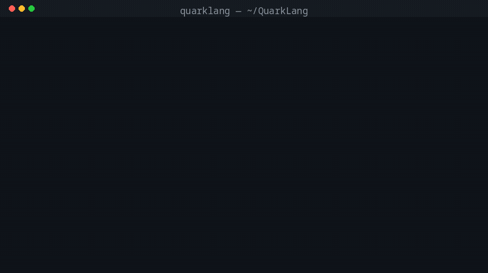

# QuarkLang (qkc)

[](https://github.com/QuarkLangCommunity/QuarkLangQkc/actions/workflows/ci.yml)
[](https://github.com/QuarkLangCommunity/QuarkLangQkc/actions/workflows/release.yml)
[](https://github.com/QuarkLangCommunity/QuarkLangQkc/releases/latest)


**QuarkLang is a type-first compiled language with two backends for one source file** — a Go interpreter
(edit and run) and an LLVM compiler `qkc` (its performance is measured against C in the generated
[performance section](#performance-measured-reproducible); the observable tide is measured separately below).
It targets **compute-heavy, highly concurrent, allocation-heavy CLI and service workloads**:
recursive `fib(35)` compiled to native code, Erlang-style user-space tasks, and an interpreter block
allocator with no GC pauses.
It ships with a linter, doc generator, REPL, language server and editor support — and **zero third-party Go dependencies**.

| You are… | You get… |
|---|---|
| Looking for a language that is genuinely fast once compiled | Compiled-path performance measured against C in the generated block, including the gap; the latency rows are measured there too |
| Writing CLIs, scripts or long-running services | Instant feedback with the interpreter; one command to compile with `qkc -run` |
| Needing concurrency without GC pauses | `taskm` user-space tasks + thread pool; block allocation, no GC pauses |
| Building editor/tooling integrations | Stable CLIs, an LSP server, a tree-sitter grammar, `-json` machine-readable diagnostics |

<p align="center"></p>

> Everything in the GIF is real output (regenerate it with `scripts/make-demo-gif.py`):
> `quark hello.qk` → `qkc -run hello.qk` → `QK_LANG=en qkcheck examples/` (a genuine warning, not a mock-up).
> The last line demonstrates the bilingual tooling: the same command prints Chinese by default.

## 🚀 Quick start

```sh
# ① Prebuilt binary (Linux x86_64; macOS / Windows have their own assets on the Releases page)
curl -fsSL https://github.com/QuarkLangCommunity/QuarkLangQkc/releases/latest/download/quark-linux-amd64 -o quark \
  && chmod +x quark && ./quark examples/hello.qk
```

```sh
# ② From source (one line; requires Go ≥ 1.26)
git clone --depth 1 https://github.com/QuarkLangCommunity/QuarkLangQkc && cd QuarkLangQkc \
  && go build -o quark . && ./quark examples/tour.qk
```

```sh
# ③ Compile and run (native LLVM; requires clang)
cd compiler && go build -o qkc . && ./qkc -run ../examples/hello.qk
```

```sh
# ④ Toolchain (all reuse the same front end): lint / docs / REPL / language server
go build -o qkcheck ./cmd/qkcheck && ./qkcheck examples/          # exits 1 on findings; -json for CI
go build -o qkdoc   ./cmd/qkdoc   && ./qkdoc -o API.md examples/tour.qk
go build -o qkrepl  ./cmd/qkrepl  && ./qkrepl -e "int x = 6;" -e "x * 7"
go build -o qklsp   ./cmd/qklsp   && ./qklsp                      # editor integration in editors/
```

```sh
# ⑤ Install the compiler as a Go module (no checkout; requires Go ≥ 1.26)
go install github.com/QuarkLangCommunity/QuarkLangQkc/compiler@v1.1.1
```

`v1.1.1` is the current Go module version, and the module is the supported distribution path for the
compiler: the tag carries the public module path with the compiler inside the root module. The `v2.x`
project tags are not Go module versions for this path, so `@latest` resolves to `v1.1.1`; see
`docs/module-consumability.md` for the measurements and the tag rule.

`v1.1.0` was the first consumable module tag but has **no release assets**: its tag-triggered
`release.yml` run failed because the workflow pinned Go 1.21 while `go.mod` requires Go 1.26. `v1.1.1`
was tagged after that pin was fixed, so it is the first tag that is both consumable as a module and has
published assets. The Go module line advances independently of the project's `VERSION`/release numbering
(`2.1.0`).

> Project releases such as `v2.1.0` ship both **versioned** assets (`quark-2.1.0-linux-amd64`) and
> **version-less aliases** (`quark-linux-amd64`) so scripts can pin a stable URL. Verify downloads against
> `MANIFEST-<version>-<platform>.txt` (sha256). The `v1.1.1` module release publishes the version-less
> binaries built by `release.yml`.

<details>
<summary>Building from source: full notes (interpreter / compiler dependencies)</summary>

### One Go module (`github.com/QuarkLangCommunity/QuarkLangQkc`)

```sh
go build -o quark .
./quark examples/hello.qk
go test ./internal/lang/     # full test suite (-race works too)
```

### Compiler (`compiler/`, LLVM backend; same module)

```sh
cd compiler && go build -o qkc .
./qkc -run hello.qk          # LLVM IR → clang native → execute
./qkc hello.qk               # emit IR only
```

**Requirements**: Go ≥ 1.26 (zero third-party Go dependencies); an LLVM toolchain (`clang`/`lli`/`llvm-as`).
Optional `rustc`/`gcc` are only needed for the cross-language benchmark suite.

</details>

## Language

Tool messages and generated documentation are **bilingual (Chinese / English)**:

```sh
QK_LANG=en qkcheck examples/          # environment variable (explicit; nothing else is consulted)
qkcheck --lang en examples/           # per-invocation flag (also: --lang zh)
qkc --lang en hello.qk                # all CLIs accept --lang: quark/qkc/qkcheck/qkdoc/qkrepl/qklsp
```

- **The default follows your system locale**: an English machine reports English, a Chinese machine Chinese; `QK_LANG` (or `--lang`) always wins.
- Untranslated messages **fall back to Chinese rather than disappearing** — information is never dropped.
- Coverage is enforced in CI: `TestTableCoversWiredTemplates` fails if a wired Chinese message has no English entry,
  and `TestEnglishModeRendersEnglish` renders real type/parse/lint failures in English and rejects any leftover Chinese.
- New messages: add the Chinese template to your call site via `i18n.T(...)`, then register the English in
  `internal/i18n/table.go` (the test lists exactly what is missing).

## Contents

[Quick start](#-quick-start) · [Language tour](#language-tour) · [Toolchain](#toolchain) · [Highlights](#highlights) ·
[Performance](#performance-measured-reproducible) · [Cross-platform](#cross-platform-linux--macos--windows) ·
[Language features](#language-features-v2-syntax) · [Ecosystem](#ecosystem) · [Project layout](#project-layout) ·
[Contributing](#contributing) · [Spec (Chinese)](https://github.com/QuarkLangCommunity/QuarkLangQkc/blob/docs/spec.md)

## Language tour

The most honest introduction is code that runs. This is `examples/tour.qk` — it produces
**byte-identical output on both backends** (interpreter and compiler):

```qk
program main;

/* Language tour
 * Type-first syntax: struct/impl, generics, try/catch, List — runnable as-is.
 * Identical output on both backends. */

type struct { int x; int y; } Point;            // struct

impl {
    fn new(int x, int y) Point {                // static method (no self)
        Point p = .{x: x, y: y};                // struct literal (field name: value)
        return p;
    }
    fn sum(Point self) int {                    // instance method (first param is self)
        return self.x + self.y;
    }
} Point;                                         // name after the block

fn<T> twice(T v) T { return v; }                // generics, type-erased

fn main(IOStream io) {
    Point p = Point::new(3, 4);                 // static call with ::
    io.println("point sum =", p.sum());         // instance call with .

    List<int> l = [1, 2, 3];
    int total = 0;
    for (int v : l) { total = total + v; }
    io.println("list total =", total);

    try {
        io.println(1 / 0);
    } catch (void e) {                          // catchable error
        // Using `e` inside catch is not supported on the compiler path yet.
        // Both backends only print a "caught" notice.
        io.println("caught: division by zero");
    }
    io.println("twice =", twice(21));
}
```

```sh
$ quark examples/tour.qk        # or: qkc -run examples/tour.qk
point sum = 7
list total = 6
caught: division by zero
twice = 21
```

<details>
<summary>More runnable examples</summary>

```sh
quark examples/hello.qk
quark examples/fib.qk
quark examples/struct.qk
quark examples/macro.qk
quark examples/sum.qk
```

</details>

## Toolchain

| Tool | Purpose | One-liner |
|---|---|---|
| `quark` | Interpreter: edit-and-run, REPL-friendly | `./quark examples/hello.qk` |
| `qkc` | LLVM compiler / library artifacts / preprocessor | `./qkc -run hello.qk` (IR: `./qkc hello.qk`) |
| `qkcheck` | Static analysis QK101–QK115; `-json` for CI/editors | `./qkcheck examples/` |
| `qkdoc` | `/* */` + `pub` → Markdown / HTML API docs | `./qkdoc -o API.md lib.qk` |
| `qkrepl` | Interactive evaluation: multi-line blocks, persistent environment | `./qkrepl -e "int x = 6;" -e "x * 7"` |
| `qklsp` | Language server: diagnostics / definition / completion / hover / outline | `./qklsp` (VS Code extension in `editors/vscode`) |

### Static analysis: qkcheck

```sh
go build -o qkcheck ./cmd/qkcheck
./qkcheck examples/                                  # files or directories; exit 1 on findings
./qkcheck -json -L ../QuarkLangLibs-Style lib.qk     # machine-readable; -L adds import search paths
./qkcheck -params src.qk                             # also check unused parameters
```

| Code | Check | Notes |
|---|---|---|
| QK101 | Unused variable | Declared but never read (including write-only); a `_` prefix is ignored |
| QK102 | Unused parameter | Requires `-params` (interface implementations often ignore parameters) |
| QK103 | Unreachable code | Statements after `return`/`log`/`break`; after both branches return |
| QK104 | Shadowing | `for` (both forms) / `catch` variables shadowing an outer name (three places the compiler misses) |
| QK105 | Missing return | A non-void function has a path that ends without a value (the interpreter yields nil, `qkc` zero-fills — the two disagree) |
| QK106 | Interface not implemented | Near-miss: some methods implemented, the rest missing (missing names are listed) |
| QK107 | void value misuse | Calling a void function and using the result as a value (nil at runtime) |
| QK108 | Self assignment | `x = x` / `p.x = p.x` / `l[i] = l[i]` (structurally equivalent, no effect) |
| QK109 | Constant condition | `if (true/false)`, `while (false)`; `while (true)` with no `break`/`return` (likely infinite loop) |
| QK110 | Division by a constant zero | Literal `/ 0`, `% 0`; **exempt inside `try`** (deliberate error handling) |
| QK111 | Unused import | Imported but no symbol used; skipped when the library cannot be resolved |
| QK112 | Shadowing a global function | Local variable/parameter shadowing a **global function** name (calls would resolve to the local) |
| QK113 | Dead store | An assignment (or declaration initializer) overwritten before any read; **reference writes and assignments inside loops are exempt** |
| QK114 | Self comparison | `x == x` (always true) / `x != x` (always false) |
| QK115 | Function never called | Only for `program main` (has `main`, no `pub`): a function never referenced anywhere is dead code; library files are exempt |

**False positives / false negatives (hand-labelled benchmark + randomized statistics with P99)**

```sh
# ① Hand-labelled benchmark (29 cases: 15 defects + 14 clean, including deliberate "must not report" cases)
go test ./internal/lang/ -run TestLintBenchmark -v

# ② Randomized statistics: 4 ground-truth cases per round, P50/P90/P99/max across rounds (2000 by default)
go test ./internal/lang/ -run TestLintStatsP99 -v
LINT_ROUNDS=20000 LINT_SEED=7 go test ./internal/lang/ -run TestLintStatsP99 -v   # dig into the tail

# ③ Real-corpus perturbation invariance (CRLF / trailing comments / inserted header lines / trailing whitespace)
go test ./internal/lang/ -run 'TestLintCorpusPerturbation|TestLintCRLF' -v
```

A single deterministic run says nothing about the tail, so the statistical test generates programs with
**known ground truth** (diagnostic code + line) and reports per-round FP/FN quantiles:

| Metric (per round) | seed=1 | seed=7 | seed=20260918 |
|---|---|---|---|
| FP: P50 / P90 / P99 / max | 0 / 0 / 0 / 0 | 0 / 0 / 0 / 0 | 0 / 0 / 0 / 0 |
| FN: P50 / P90 / P99 / max | 0 / 0 / 0 / 0 | 0 / 0 / 0 / 0 | 0 / 0 / 0 / 0 |
| FP rate / FN rate at P99 | 0.0% / 0.0% | 0.0% / 0.0% | 0.0% / 0.0% |

**3 seeds × 2000 rounds × 4 cases = 24,000 randomized cases (12,000 injected defects)**, with P99 and max at 0.
The harness itself caught real problems: an over-broad QK115 rule (it skipped whole files containing `pub`),
plus two defects in the benchmark generator.

| Metric | Before hardening | After |
|---|---|---|
| Cases (15 defects + 14 clean) | 21 | 29 |
| TP / FP / FN | 6 / 1 / 14 | **20 / 0 / 0** |
| FP rate | 14.3% | **0.0%** |
| FN rate | 70.0% | **0.0%** |

<details>
<summary>qkdoc: API documentation generation</summary>

```sh
go build -o qkdoc ./cmd/qkdoc
./qkdoc lib.qk                       # Markdown to stdout
./qkdoc -all -o API.md style.qk      # include non-pub symbols, write to a file
./qkdoc -html -o API.html style.qk   # self-contained HTML (no external assets)
```

- Doc comments: the `//` or `/* */` block **immediately above** a declaration (godoc rule); falls back to a
  trailing comment on the same line (`int x; // x coordinate`); the file header comment becomes the file description.
- Only `pub` symbols are exported by default; files without `pub` (e.g. `program main`) export everything.
  `impl`/`space`/`library`/`#macro` are not filtered by `pub` (the language cannot prefix them with `pub`,
  and they are what library APIs consist of; macros are split out before parsing and supplied by `ParseSourceAll`).
- The checked-in `style.qk` (1,567 lines) generates 335 lines of Markdown (overview table + sections);
  `scripts/bench-tools.sh` measures the process time, but it writes no record, so no time is quoted.

</details>

<details>
<summary>qkrepl: interactive evaluation</summary>

```sh
go build -o qkrepl ./cmd/qkrepl
./qkrepl                      # interactive: qk> prompt, auto-continues with ..> for open blocks
./qkrepl -e "int x = 6;" -e "x * 7"   # one-shot evaluation (segments share one environment)
printf 'fib(20)\n' | ./qkrepl # batch mode (stdin is not a terminal)
```

```
qk> fn fib(int n) int {      # multi-line block: '{' not closed → continuation
..>     if (n <= 1) { return n; }
..>     return fib(n - 1) + fib(n - 2);
..> }
defined fn fib(int n) int
qk> fib(20)
6765
```

- **Persistent environment**: variables/functions/types/interfaces/impls survive across inputs; redefining a function overrides it.
- Expressions print their value; `log` records and `io.println` output appear immediately; a trailing `;` is optional.
- Commands: `:help`, `:quit`, `:load <file.qk>` (register declarations from a file, then call `main(io)`).

</details>

<details>
<summary>Editor support: qklsp + VS Code + tree-sitter</summary>

```sh
go build -o qklsp ./cmd/qklsp        # language server (stdio LSP)
./qklsp -L ../QuarkLangLibs-Style    # extra import search path
```

| Capability | Notes |
|---|---|
| Diagnostics | Parse/type errors (`qkc`) + static analysis (qkcheck QK101–QK107), correctly located across imported files |
| Go to definition | Functions/structs/interfaces/spaces/fields/locals (UTF-16 column conversion, accurate in non-ASCII sources) |
| Completion | Keywords + built-in types/methods + symbols declared in the current file |
| Hover / outline | Signature + doc comment; `documentSymbol` lists all top-level symbols |

Editor artifacts: `editors/vscode` (VS Code extension: TextMate grammar, snippets, zero-dependency LSP client),
`editors/tree-sitter-quarklang` (tree-sitter grammar, usable from Neovim/Helix/Emacs).

**In the browser**: <https://quarklangcommunity.github.io/QuarkLangPlayground/> runs the interpreter as
WebAssembly (`cmd/quarkwasm`, `GOOS=js GOARCH=wasm`) inside a Web Worker — live diagnostics while typing,
`io.readln()` stdin, six examples and share-by-URL. The app lives in
[QuarkLangPlayground](https://github.com/QuarkLangCommunity/QuarkLangPlayground); its CI builds the engine
from this repository (never vendored) and compares every example byte for byte against the interpreter.

**Measured**: the tree-sitter grammar parses **60 `.qk/.kq` files with 0 errors** (including the 1,567-line
`style.qk` and `cleg.qk`), and `tree-sitter test` passes 5/5; `editors/vscode/test/protocol.test.js` connects
to a real `qklsp` over stdio and passes 8/8 checks.

</details>

<details>
<summary>Release artifacts and versioning (how to cut your own release)</summary>

```sh
./scripts/build-release.sh 2.1.0     # 3 platforms × 2 architectures × 6 tools → dist/ (version injection + sha256 manifest)
./scripts/changelog.sh 2.1.0         # changelog since the previous tag, grouped by kind
./scripts/changelog.sh --all > CHANGELOG.md
git tag v2.1.0 && git push origin v2.1.0   # triggers the release workflow: native builds on three platforms → GitHub Release
```

- **Version injection**: the `VERSION` file is the single source of truth; builds inject it via
  `-ldflags "-X main.version=…"`, so `quark/qkc/qkcheck/qkdoc/qkrepl/qklsp --version` all report it.
- **Artifacts**: `dist/<tool>-<version>-<os>-<arch>[.exe]` plus `MANIFEST-<version>.txt` (sha256 + size).
  The local script cross-compiles with `CGO_ENABLED=0` (portable, no system dependencies), while the release
  workflow builds **natively on each platform with cgo enabled** (so `library`/dlopen FFI works).
- The release workflow also uploads version-less aliases (`quark-linux-amd64`, …) for stable URLs, and
  publishing is gated by a GitHub Environment that requires a human approval.

</details>

## Highlights

- **Compiled performance is measured, not asserted**: the generated block below compares the
  compiled path with C, Rust, Go and Erlang on the same `fib` workloads and reports the gap; there is
  no parity slogan. Allocation-heavy loops are measured separately in the tide block.
- **Erlang-style concurrency**: `spawn/merge/block/done/channel` user-space tasks on a thread pool — Erlang's model with C-level performance.
- **Zero-GC memory**: the interpreter uses a linear block policy over the host allocator, and the
  compiled path (stage 1) uses counted slabs with per-object release; `delete` preserves the payload,
  `clear` wipes; the checked-in `bench/tide` policy workload measures reuse, fragmentation and block
  count (`docs/tide-benchmark.md`).
- **Mathematical `sum` optimization**: closed form for linear/periodic/uniform-random sums — 1e9 terms
  in O(1), measured against a Go loop in the generated block.
- **Incremental compilation**: two-level IR + binary cache; the rebuild multiple has no checked-in
  producer and is not quoted.
- **Zero third-party dependencies**: lexer, parser, type checker, evaluator and LLVM IR emission are all hand-written.

### Interpreter execution model

The interpreter runs functions through two engines, chosen per function and never observable from the
outside:

| Engine | When |
|---|---|
| **Bytecode VM** | the whole function body fits the compiled subset: int/bool arithmetic and comparisons, `if`/`while`/C-style `for`, direct calls, `return`, `log`, `io.print`/`io.println` |
| **Tree-walker** | everything else — strings, lists, structs, interfaces, macros, taskm, `try/catch`, method calls beyond `io.*`, overload resolution by argument type |

The VM is adopted only for shapes where the engine-equality tests hold it to the tree-walker's output.
The old three-row speed table compared against an engine this tree no longer selects; it is withdrawn
and the earlier figures are recorded in the [performance-claims inventory](docs/performance-claims-inventory.md).

The VM reuses the interpreter's own primitives (`wrapI32`, `callFunc`, `ioPrintln`) and its error
values. When a value's runtime type does not match the statically proven type (the language allows
implicit int→float promotion, so an `int` parameter can legitimately receive a float), the function
**deoptimizes**: it is blacklisted and re-run by the tree-walker, which is why
`compiler/testdata/compare.sh` still prints `all identical`. `TestVMEqualsTreeWalker`,
`TestVMCompilesHotShapes` and `TestVMEqualsTreeWalkerOnCorpus` (22 corpus programs) hold both engines
to identical output; `QUARK_NO_VM=1` disables the VM entirely.

## Performance (measured, reproducible)

Every number in this section is generated from a checked-in record; the two blocks below are the
claim, and a test fails when a quoted copy and the record disagree. The claims harness covers the
cross-language `fib` family, the closed-form `sum`, the `fib(20)` latency percentiles and the
interpreter-versus-native rows; the tide harness covers allocation. The inventory of earlier figures
that were corrected or withdrawn is [`docs/performance-claims-inventory.md`](docs/performance-claims-inventory.md).

### Claims: fib, sum, latency and the two backends

`bench/claims/run.sh` builds one workload per row, runs it five times after a warm-up, and reports the
median, minimum, maximum, standard deviation and spread. Every run prints its result as a checksum,
and a checksum that changes between runs fails the harness. A recording run is refused unless the
host's 1-minute load average is below 0.25 per logical CPU, and the block states the load it was taken
under. `--record` has no `--n` override: the rounds are fixed by the checked-in sources and by
`spec/bench/claims-shapes.tsv`, and the generator rejects a row that does not match that shape.

<!-- performance-claims -->
Measured on Linux x86_64, 16 logical CPUs. Load: 1-minute load average 1.66 before the run; precondition below 4.00 (0.25 per logical CPU on 16 logical CPUs). Toolchain: clang version 22.1.8 (Fedora 22.1.8-4.fc44); go version go1.26.9-X:nodwarf5 linux/amd64; rustc 1.99.0 (b940084d7 2026-09-28) (Fedora 1.99.0-1.fc44); Erlang/OTP 26. Flags: qkc default -O3 -flto=thin; C clang -O3 -flto=thin; Rust rustc -O; Go go build (default); Erlang erlc (default). Skipped controls: none.

What is counted: in-process wall time: clock()/clock_gettime(CLOCK_MONOTONIC)/Instant::now()/time.Now()/timer:tc(); process startup and printing excluded; every row prints its result as a checksum. Evidence: every workload prints its result as the checksum; the harness fails when the checksum changes between runs; the C, Rust and Go fib controls read the argument from argv so the optimizer cannot constant-fold the recursion.

| Workload | Language | Rounds | Runs | Median | Min–max | Spread | Checksum | What is counted |
|---|---|---:|---:|---:|---:|---:|---:|---|
| fib(30), QuarkLang compiled | QuarkLang | 1 | 5 | 4.77 ms | 4.69–5.86 ms | 24.61% | 832,040 | recursive fib(30), result printed as the checksum |
| fib(30), C control | C | 1 | 5 | 2.32 ms | 2.01–2.95 ms | 40.36% | 832,040 | recursive fib(30) with a volatile argument |
| fib(30), Rust control | Rust | 1 | 5 | 1.91 ms | 1.56–2.86 ms | 68.08% | 832,040 | recursive fib(30), argument from argv |
| fib(30), Go control | Go | 1 | 5 | 3.01 ms | 2.83–4.73 ms | 62.79% | 832,040 | recursive fib(30), argument from argv |
| fib(30), Erlang control | Erlang | 1 | 5 | 7.57 ms | 5.81–8.89 ms | 40.66% | 832,040 | recursive fib(30) timed with timer:tc |
| fib(35), QuarkLang compiled | QuarkLang | 1 | 5 | 49.68 ms | 47.95–50.37 ms | 4.87% | 9,227,465 | recursive fib(35), result printed as the checksum |
| fib(35), C control | C | 1 | 5 | 21.90 ms | 21.43–22.73 ms | 5.92% | 9,227,465 | recursive fib(35) with a volatile argument |
| fib(35), Rust control | Rust | 1 | 5 | 21.43 ms | 16.71–24.23 ms | 35.11% | 9,227,465 | recursive fib(35), argument from argv |
| fib(35), Go control | Go | 1 | 5 | 35.06 ms | 32.86–35.28 ms | 6.90% | 9,227,465 | recursive fib(35), argument from argv |
| sum over 1e9 terms, QuarkLang closed form | QuarkLang | 1,000,000,000 | 5 | 0 µs | 0–0 µs | 0.00% | 1,565,039,360 | one sum(ident, 0, 1e9) call; the elapsed time is below clock()'s 1 us resolution on this build |
| sum over 1e9 terms, Go loop | Go | 1,000,000,000 | 5 | 241.58 ms | 240.52–253.26 ms | 5.27% | 1,565,039,360 | the same terms added by a plain Go loop |
| fib(20) P50, QuarkLang compiled | QuarkLang | 1,000 | 5 | 36 µs | 34–37 µs | 8.33% | 6,765 | P50 of 1000 fib(20) calls, found by counting and binary search |
| fib(20) P50, C control | C | 1,000 | 5 | 14 µs | 14–16 µs | 14.29% | 6,765 | P50 of 1000 fib(20) calls, found by counting and binary search |
| fib(20) P99, QuarkLang compiled | QuarkLang | 1,000 | 5 | 42 µs | 41–46 µs | 11.90% | 6,765 | P99 of 1000 fib(20) calls, found by counting and binary search |
| fib(20) P99, C control | C | 1,000 | 5 | 20 µs | 16–31 µs | 75.00% | 6,765 | P99 of 1000 fib(20) calls, found by counting and binary search |
| fib30, interpreter | QuarkLang interpreter | 1 | 5 | 193.77 ms | 188.80–208.06 ms | 9.94% | 832,040 | the same source run by the interpreter, timed in-process |
| fib30, native qkc | QuarkLang compiled | 1 | 5 | 4.86 ms | 4.59–5.27 ms | 13.86% | 832,040 | the same source compiled by qkc, timed in-process |
| loop, interpreter | QuarkLang interpreter | 10,000,000 | 5 | 559.49 ms | 554.17–591.48 ms | 6.67% | 29,999,994 | the same source run by the interpreter, timed in-process |
| loop, native qkc | QuarkLang compiled | 10,000,000 | 5 | 4.47 ms | 3.33–5.53 ms | 49.19% | 29,999,994 | the same source compiled by qkc, timed in-process |
| list, interpreter | QuarkLang interpreter | 1e6 | 5 | 168.21 ms | 159.86–183.79 ms | 14.23% | 499,500,000 | the same source run by the interpreter, timed in-process |
| list, native qkc | QuarkLang compiled | 1e6 | 5 | 7.33 ms | 6.00–8.87 ms | 39.15% | 499,500,000 | the same source compiled by qkc, timed in-process |
| struct, interpreter | QuarkLang interpreter | 1e6 | 5 | 273.16 ms | 260.75–283.94 ms | 8.49% | 4,999,997 | the same source run by the interpreter, timed in-process |
| struct, native qkc | QuarkLang compiled | 1e6 | 5 | 2.06 ms | 1.31–2.11 ms | 38.59% | 4,999,997 | the same source compiled by qkc, timed in-process |
| hash, interpreter | QuarkLang interpreter | 1e6 | 5 | 280.03 ms | 268.96–302.59 ms | 12.01% | 499,500,016 | the same source run by the interpreter, timed in-process |
| hash, native qkc | QuarkLang compiled | 1e6 | 5 | 213.20 ms | 207.89–238.65 ms | 14.43% | 499,500,016 | the same source compiled by qkc, timed in-process |
| str, interpreter | QuarkLang interpreter | 50,000 | 5 | 293.84 ms | 281.50–304.80 ms | 7.93% | 100,000 | the same source run by the interpreter, timed in-process |
| str, native qkc | QuarkLang compiled | 50,000 | 5 | 726.92 ms | 704.27–753.56 ms | 6.78% | 100,000 | the same source compiled by qkc, timed in-process |
<!-- /performance-claims -->

### Tide: observable allocation

The tide row is measured by `bench/tide/run.sh`; the generated block below is embedded here and in
`spec/STANDARD.md` §10, and `TestTideClaimsMatchMeasurement` fails when the three copies differ. It
reports the observable path, the no-sink and historical no-use rows, and the interpreter's
block-policy counters. Since stage 1 of the compiled memory design the compiled `List` allocation goes
through the counted-slab runtime allocator on POSIX, so the no-sink and no-use rows are no longer
optimizer floors; the historical row is kept to show that the optimizer can no longer erase it. A
recording run is refused unless the host's 1-minute load average is below 0.25 per logical CPU, and
the generated block states the load the numbers were taken under.
Reproduce the tide block with `bench/tide/run.sh` and the claims block with `bench/claims/run.sh`.

<!-- tide-measurements -->
Measured on Linux x86_64, 16 logical CPUs. Load: 1-minute load average 0.98 before the run; precondition below 4.00 (0.25 per logical CPU on 16 logical CPUs). Toolchain: clang version 22.1.8 (Fedora 22.1.8-4.fc44); go version go1.26.9-X:nodwarf5 linux/amd64; rustc 1.99.0 (b940084d7 2026-09-28) (Fedora 1.99.0-1.fc44). Flags: qkc default -O3 -flto=thin; C clang -O3 -flto=thin; Rust rustc -O; Go go build (default). Skipped controls: none.

What is counted: in-process loop wall time: clock()/clock_gettime(CLOCK_MONOTONIC)/Instant::now()/time.Now(); process startup and printing excluded; observable rows call an opaque sink so the allocation cannot be removed. Evidence: the observable QuarkLang binary defines ql_alloc/ql_free and routes the List allocation and the toString string through them; it imports malloc/free only for the allocator's host blocks.

| Workload | Rounds | Runs | Median | Min–max | Spread | Checksum | What is counted |
|---|---:|---:|---:|---:|---:|---:|---|
| QuarkLang compiled, observable | 1e8 | 5 | 1.78 s | 1.70–1.81 s | 5.99% | 899,999,977 | `List<int>` literal + `toString` string (both counted slabs since D1) + opaque C sink + release + delete |
| C control, volatile sink | 1e8 | 5 | 413.44 ms | 409.50–431.13 ms | 5.23% | 899,999,977 | malloc(12) + 3 writes + volatile sink + free |
| Rust control, black_box | 1e8 | 5 | 675.99 ms | 634.53–867.62 ms | 34.48% | 899,999,977 | Vec::with_capacity(3) + 3 pushes + black_box(ptr) + drop |
| Go control, global sink | 1e8 | 5 | 1.48 s | 1.43–1.53 s | 6.58% | 899,999,977 | make([]int32,3) + global sink + GC |

The same loops without the sink. The checksum keeps the loop alive; on the pre-stage-1 libc path the legacy row removed the use entirely. Since stage 1 the QuarkLang rows call the opaque counted-slab allocator, so they measure allocation too; the C/Rust/Go floor rows still measure their own optimizer floors.

| Workload | Rounds | Runs | Median | Min–max | Spread | Checksum | What is counted |
|---|---:|---:|---:|---:|---:|---:|---|
| QuarkLang compiled, no sink | 1e8 | 5 | 809.13 ms | 660.88–987.90 ms | 40.42% | 899,999,977 | same loop with the sink removed; the checksum keeps the loop alive; the opaque ql_alloc/ql_free calls are not elided |
| C control, no sink (optimizer floor) | 1e8 | 5 | 141.80 ms | 94.06–220.25 ms | 88.99% | 899,999,977 | same loop with the volatile sink removed |
| Rust control, no black_box (optimizer floor) | 1e8 | 5 | 180.75 ms | 173.41–332.45 ms | 87.99% | 899,999,977 | same loop with black_box removed |
| Go control, local slice (optimizer floor) | 1e8 | 5 | 217.91 ms | 161.14–220.16 ms | 27.08% | 899,999,977 | same loop with the global sink removed |
| QuarkLang compiled, legacy shape (no read/sink) | 1e8 | 5 | 620.70 ms | 535.74–699.54 ms | 26.39% | - | allocate/delete with no read, sink or checksum: the shape the old 1 ms claim measured on the pre-stage-1 libc path; stages 1-2 run it through counted slabs |

The historical `1 ms` claim measured the legacy row on the pre-stage-1 libc path, where LLVM removed the loop; that is what `0 µs` meant. On the stage-1 tree the same row is no longer erased (the allocator call is opaque), so the recorded value is a real allocation measurement and the label no longer calls it a dead-code floor.

| Policy measurement | Waves | Allocations | Value | Note |
|---|---:|---:|---:|---|
| Interpreter block policy, reuse workload | 10,000 | 1,000,000 | 99.9998% | ReusedCount/AllocCalls; the block count converges to 2 blocks |
| Interpreter block policy, mixed survival | 1,000 | 1,000,000 | 0.1953% | Fragmentation() after the mixed-size waves; 3005 blocks stay live by design |
<!-- /tide-measurements -->

> **On the tide numbers.** The earlier `1 ms` row was LLVM dead-code elimination, not an allocation
> measurement; the block above keeps that shape only as a labelled floor. The observable compiled tide
> includes `List.toString()`, the only opaque sink the compiler exposes, while the C control is the
> minimal `malloc`/`free` shape; the harness reports both, so the observable path and the floor cannot be
> confused.

> **On the compiled-path numbers.** The generated claims block is the claim. On the reference class the
> QuarkLang `fib` rows are slower than the C control (the block shows the medians, ranges and spread),
> and the latency rows are slower at both percentiles. Both paths use LLVM `-O3`; the gap is in the code
> the compiler emits, not in the choice of backend. The earlier "same as C" wording and the `21 ms` and
> `14/27 µs` figures did not survive measurement and were corrected, not footnoted. The interpreter is
> not a speed feature; it exists to remove the compile step and keep REPL state. It has no checked-in
> CPython control, so no comparison with CPython is quoted.

The claims block also carries the interpreter-versus-native rows: the same checked-in programs, timed
in-process on both backends, with output parity required. Two rows contradict the earlier table and
are left visible: the Erlang `fib(30)` control is far faster than the withdrawn four-digit figure, and
the native `str` binary is slower than the interpreter on this build, so the old "quadratic on both
paths" note did not survive. `scripts/bench-report.sh` remains a manual report; it writes no record,
so its output is not quoted here.

<details>
<summary>Toolchain performance work (including a measured rule for when to offload work to C libraries)</summary>

```sh
scripts/bench-tools.sh 9          # real process-level timings (median of 9 runs per scenario)
go test ./internal/lang/ -run XXX -bench . -benchmem    # library-level benchmarks (interpreter)
```

The before/after table this section used to show compared binaries that are not in the tree: the
"before" column cannot be rebuilt from this checkout, so the table was withdrawn rather than restated.
`scripts/bench-tools.sh 9` measures the current tree (median of 9 runs per scenario), but it writes no
record, so no number from it is a claim.

**When is it worth offloading a service to a C library? (one-off observations, no recorded claim)**

| Criterion | Finding | Conclusion |
|---|---|---|
| Fixed cgo call overhead | a one-off local probe; no checked-in producer | Offloading "one small step" services (per-token lexing, per-key hashing, short string builtins) always loses |
| Whole-file lexing | the C scan was not enough faster than the Go scan to pay for rebuilding tokens; the experiment was reverted | rejected |
| Regex matching | the sibling `QuarkLangLibs-Regex` repository owns the comparison; this repository records no number | the PCRE2 backend is adopted there |

In one sentence: **coarse-grained services that do a whole pass per call** (regex, codecs, graphics, compression)
are worth offloading; **fine-grained services interleaved with the interpreter** (lexing, evaluation, hashing) are better left in Go.

Key optimizations (all profile-driven):

1. **Copy-free lexing / macro splitting**: `SplitMacroDefs` returns the original token slice when a file has no `#`;
   `lex` preallocates token capacity; single-character tokens use a precomputed string table.
2. **No duplicate parsing**: files without imports are type-checked directly from the already-parsed AST (`Typecheck(prog)`);
   qklsp does the same.
3. **Compile-time variable slot resolution** (`slots.go`): locally provable variables become slot indices
   (parameters plus prefix top-level declarations only, and only where no `for-in`/`catch`/C-style `for` scope intervenes),
   with a runtime `paramNames[slot] == name` guard that falls back to the slow path if the inference is ever wrong.
4. **`Value.deref` split into fast/slow paths**: the hot sentinel check inlines; the deref loop moved to `derefSlow`.
5. **Argument arena + interned reference handles**: argument slices are borrowed from the context's `argArena`
   and returned by watermark after the call (the async taskm path copies explicitly); `refIdent` handles are
   stateless and interned per (scope, name).
6. **Editor-side caches**: the symbol table and completion candidates are cached per document version;
   diagnostics reuse the AST; rendering avoids `fmt` and preallocates.

</details>

## Cross-platform (Linux / macOS / Windows)

```
.github/workflows/ci.yml
├── test (matrix: ubuntu-latest / macos-latest / windows-latest)
│     go build ./... + go test ./...   # interpreter, toolchain, editor artifacts
│     + qkcheck multi-round P99 gate (LINT_ROUNDS=2000)
│     + corpus perturbation invariance (CRLF / comments / line shifts)
└── linux-extras (the parts that need clang / bash / node)
      dual-path comparison · tree-sitter · VS Code LSP integration · release & benchmark smoke tests
```

- **The same Go tests run on all three platforms**: no shell dependencies, no hard-coded paths (`testing.TempDir`).
- **Identical line handling**: CRLF and LF produce identical token positions (`TestLintCRLF`); 36 real corpus files keep
  an identical diagnostic set under CRLF (`TestLintCorpusPerturbation`).
- **Identical paths**: `qklsp` emits spec-compliant `file://` URIs (Windows `C:/x` → `file:///C:/x`, with the leading
  slash stripped when converting back) — covered by unit tests.
- **Cross-compilation**: three platforms × two architectures via `CGO_ENABLED=0` (`scripts/build-release.sh`);
  the release workflow builds natively on each platform with cgo enabled.

## Language features (v2 syntax)

> The canonical syntax reference is [`SYNTAX.md`](SYNTAX.md).

<details>
<summary>Full feature list</summary>

- **Functions**: explicit return types; `return expr` ends and returns; `log expr;` records and ends.
- **try/catch**: `try { } catch (void e) { }` — errors such as division by zero are catchable.
- **void = empty interface**: any value can be assigned to it.
- **struct / impl / interface**: `type struct { int x; } Point;`,
  `impl { fn sum(Point self) int {...} } Point;`, `.{x: 3, y: 5}` literals, `self.a` field access.
- **Generics**: `fn<T, U> name(T v) T` — type-erased; call sites infer: `name(5)`.
- **Pointers / heap allocation**: `pointer T` (equivalent to `T&`), `new T[size]` (invalid sizes raise `badAlloc`),
  null dereference raises `NullPointerError`.
- **Signatures**: `f(args) @instance(prefix)` ≡ `instance.call(prefix)(.{in, out})` — memoization/wrapping.
- **taskm concurrency**: `t thread = taskm.spawn(); t.merge(fn, args); taskm.block(t.pid()); taskm.done(pid);
  c channel = taskm.channel(); c.send(v); c.recv();` — user-space tasks + thread pool (pthread carrier in the compiled path).
- **Macro system**: `#macro name (params) { body }` with named parameters; `()`/`[]`/`{}` delimiters are interchangeable;
  the body supports `#error`, and `#ifdef COMPILE` / `#ifdef EXPLAIN` select a body per engine — the
  interpreter and the compiler share both the token-level expansion and the line-level preprocessor.
- **delete/clear semantics**: `delete` returns memory to the free queue (data preserved, reusable);
  `clear` actually wipes free blocks (in-use blocks are untouched — data safety).
- **List<int>**: literals, indexing, `size()`, `get(i)`, `append(v)` (geometric growth).
- **program/library**: `program main;` / `library;`, `import`, `pub` — publishable as `.qlib` artifacts.
- **Interpreter and compiler share one syntax** (same front end, two backends).

</details>

## Ecosystem

| Project | Description | Repository |
|---|---|---|
| QuarkLangLibs-Cleg | Certified `cleg` GUI framework: `ClegNode` interface (dynamic dispatch) + `ClegWindow`/`ClegLabel`/`ClegButton`, every node driven by Style(HashTable) rendering; runtime raster kernel with a zero-allocation hot path | https://github.com/QuarkLangCommunity/QuarkLangLibs-Cleg |
| QuarkLangLibs-GL | Certified `gl` library: **OpenGL declaration set** (`library gl { ... }` binds system GL exports directly; `glc::` constant space; cross-platform dlopen/LoadLibrary + libffi) | https://github.com/QuarkLangCommunity/QuarkLangLibs-GL |
| QuarkLangLibs-Vulkan | Certified `vulkan` library: **Vulkan declaration set** (instance/device/swapchain/memory/buffer surface + `vk::` constants) | https://github.com/QuarkLangCommunity/QuarkLangLibs-Vulkan |
| QuarkLangLibs-Json | Certified `json` library: Python-style `json::dumps` / `json::loads` (objects → HashTable, arrays → List, integers → int; malformed input raises `JSONError`) | https://github.com/QuarkLangCommunity/QuarkLangLibs-Json |
| QuarkLangLibs-Regex | Certified `regex` library: pure-qk engine **or** a PCRE2-backed backend with the same API | https://github.com/QuarkLangCommunity/QuarkLangLibs-Regex |
| QuarkLangLibs-Actions | Certified `actions` library (two levels): `space` system functions (`system`/`network`, `exec`/`execv`/`popen`/`get`/`post`) + `Command`/`Network` classes implementing the `Executor` interface | https://github.com/QuarkLangCommunity/QuarkLangLibs-Actions |
| QuarkLangPlayground | **Web playground**: the interpreter compiled to WebAssembly (`cmd/quarkwasm`, `GOOS=js GOARCH=wasm`), running in a Web Worker with live diagnostics, stdin, examples and share-by-URL | https://github.com/QuarkLangCommunity/QuarkLangPlayground |

Usage: put the library's `.qk` file next to your source and `import "json";` / `import "actions";` / `import "gl";` etc.

## Project layout

- `main.go` + `internal/lang/` — interpreter (lexer / parser / type checker / evaluator / runtime / macros)
- `compiler/` — LLVM compiler (`qkc` + `internal/cgen` IR emitter + embedded thread runtime)
- `cmd/` — toolchain sharing the same front end: `qkcheck`, `qkdoc`, `qkrepl`, `qklsp`
- `cmd/quarkwasm/` — the interpreter as a WebAssembly module (the engine behind the web playground)
- `scripts/` — release & ops: `build-release.sh` (three-platform artifacts, version injection, sha256 manifest),
  `changelog.sh`, `coverage.sh` (per-package coverage report for the module), `bench-report.sh`
  (interpreter vs native on `bench/qk/`, parity asserted), `make-demo-gif.py`
- `editors/` — editor support: VS Code extension (`vscode/`) + tree-sitter grammar (`tree-sitter-quarklang/`)
- `bench/` — cross-language benchmark sources (C/Rust/Go/Erlang + Makefile) and `bench/qk/` (dual-backend programs)
- `examples/` — runnable examples (`hello.qk`, `tour.qk`, `fib.qk`, `struct.qk`, `macro.qk`, `sum.qk`)

## Branches

| Branch | Contents |
|---|---|
| `main` | Integration (interpreter + compiler + bench) |
| `interpreter` | Interpreter history |
| `examples` | Examples |
| `docs` | Design docs and generated measurement reports; also served as the project site |
| `design` | XMind design blueprint (read-only) |

## Contributing

PRs and issues are welcome. The three lowest-friction ways to get involved:

| Goal | How |
|---|---|
| Report a bug / request a feature | [Open an issue](https://github.com/QuarkLangCommunity/QuarkLangQkc/issues/new/choose) (the template asks for the right details) |
| First contribution | Pick a [`good first issue`](https://github.com/QuarkLangCommunity/QuarkLangQkc/labels/good%20first%20issue) (docs, examples, error messages, tests — no compiler internals needed) |
| Submit code | Read [CONTRIBUTING.md](CONTRIBUTING.md) → branch → PR (**`main` is protected: PR required, CI must be green**) |

- **Code of conduct**: [CODE_OF_CONDUCT.md](CODE_OF_CONDUCT.md) (Contributor Covenant v2.1).
- **Run the gates locally before pushing**:

  ```sh
  go test ./...                            # interpreter + toolchain
  (cd compiler && go test ./...)           # compiler
  (cd compiler && ./testdata/compare.sh)   # dual-path parity (must print "all identical")
  go test ./internal/lang/ -run 'TestLintBenchmark|TestLintStatsP99'   # lint FP/FN gates
  ```

- **Maintainer**: [@Enoch-199811](https://github.com/Enoch-199811) — mention in an issue or PR.

## Status

The v2 syntax surface is complete (interpreter and compiler agree). Compiled performance is measured
against the C controls in [`docs/performance-claims.md`](docs/performance-claims.md); the comparison is
shown there rather than asserted. The allocation-heavy tide is measured separately in
[`docs/tide-benchmark.md`](docs/tide-benchmark.md) on the counted-slab allocator.

## Known gaps

Written down on purpose — a young language is better judged by what it admits than by what it advertises.

- **Compiler parity is per-construct, not per-program.** The interpreter and `qkc` are held to byte-identical output
  on the checked-in corpus (`compiler/testdata/compare.sh`, enforced in CI). Constructs the compiler cannot lower yet
  produce a hard "not supported yet" diagnostic instead of a silent behavioural difference — e.g. reading the error
  value inside a `catch` body.
- **Known bug**: `return .{...};` fails with `return type is Point, got .` because the typechecker does not propagate
  an expected type into the literal yet ([issue #7](https://github.com/QuarkLangCommunity/QuarkLangQkc/issues/7)).
- **Thin standard library**: six official libraries (json, regex, cleg, gl, vulkan, actions), and still no public
  package registry. `qkm` pins dependencies in `cup.json`, mirrors them (`QKM_MIRROR`), caches them for offline
  builds (`QKM_OFFLINE=1`) and ships project templates (`qkm init -t app|cli|lib|gui|test`); `qkc -L` links `.qklib` artifacts.
- **Macro system**: token-level macros are shared by both engines, but compile-time symbol insertion (`#ast`) and
  import resolution are still in progress.
- **FFI calls** carry at most 32 arguments on every backend; the Windows x64 shim passes arguments beyond the four
  integer and four vector registers on the stack, and its error names that bound.
- **Coverage is measured for the single Go module** by `scripts/coverage.sh`; the linter's statistical gates cover its generated corpus, not all code.
- **Repository text is English-only**: comments, documentation and configuration carry no Chinese. The *runtime* is a
  separate matter: messages are authored in `internal/i18n/source/*.tsv` and rendered in the reader's language.
- **The compiled path renders in the reader's language too.** `QK_LANG=en` switches the interpreter's diagnostics and
  the text the C runtime embedded into compiled binaries prints; a program compiled by `qkc` and run under
  `QK_LANG=zh` prints exactly what it printed before the runtime's strings moved into the catalog, and
  `internal/i18n/proof/compiled_runtime.sh` is what measures both directions. This bullet used to read "compiled-path
  runtime text is Chinese-only for now", citing `越界`: the runtime's `substring`/`charAt` errors, its two parse errors
  and the test `ql_any_bad` path were hardcoded in `compiler/qthreads.c.txt`, and the two the interpreter also
  produced — `越界` and `不是合法` — rendered Chinese to an English reader because no gate could see a string that
  never reached a catalog. The one message that is still English in both languages is
  `ql_any_bad`'s interface-unboxing type error: the interpreter raises its own at type-check time instead, so that
  path has no Chinese rendering to preserve and inventing one would change shipped output; it is listed in
  `docs/i18n-design.md` §7.8.

## License

[MIT](LICENSE) © 2026 Enoch-199811
